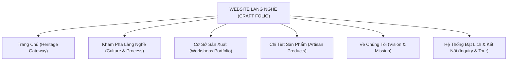
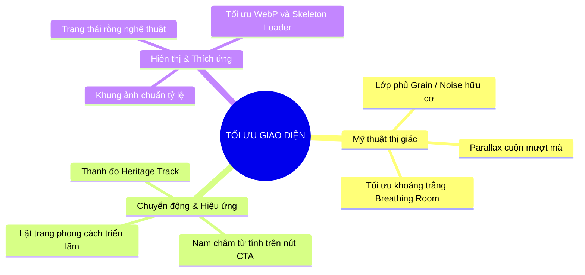
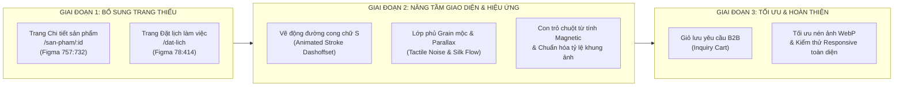

# KẾ HOẠCH CHI TIẾT HOÀN THIỆN SẢN PHẨM: CRAFT FOLIO (WEBSITE LÀNG NGHỀ)
*Bản phân tích toàn diện, đối soát thiết kế Figma, đề xuất tối ưu giao diện và lộ trình thực thi*

---

## 1. TỔNG QUAN & ĐỊNH HƯỚNG MỸ THUẬT (ART DIRECTION)

Dự án **CRAFT FOLIO** không đơn thuần là một website giới thiệu thông tin thông thường, mà là một **Digital Heritage Portfolio (Hồ sơ di sản số)** cao cấp, đóng vai trò cầu nối xúc tiến thương mại giữa các làng nghề truyền thống Việt Nam với các doanh nghiệp, đơn vị thiết kế và đối tác quốc tế.

* **Tinh thần thẩm mỹ chủ đạo**: *Đương đại hòa quyện Di sản (Contemporary Heritage)*.
* **Bảng màu nhận diện**: Màu giấy bồi ngà (`#FFFBF2` / `--bg-paper`), Đỏ son mận thủ công (`#960018` / `--brand-crimson`), Đất nung trầm (`#730000`), Khung viền chỉ cát nhạt (`rgba(223, 215, 203, 0.6)`).
* **Kiểu chữ (Typography)**: Tiêu đề nghệ thuật *1FTV Blushing Rose* sang trọng, bay bổng; nội dung thân bài *Be Vietnam Pro* thanh thoát, chỉn chu, tối ưu đọc trên mọi thiết bị.

---

## 2. KIỂM TOÁN TÌNH TRẠNG HIỆN TẠI (NHỮNG PHẦN ĐÃ HOÀN THÀNH)

Hệ thống hiện tại đã xây dựng được một nền tảng vững chắc với độ hoàn thiện cao ở các khối chính:

| Phân hệ / Trang | Các thành phần đã hoàn thành đạt chuẩn Figma | Trạng thái kỹ thuật & Trải nghiệm |
| :--- | :--- | :--- |
| **Trang chủ (`HomePage.jsx`)** | - Hero banner giới thiệu phong cách thủ công. - Danh mục Làng nghề tiêu biểu kết nối với Mega Menu. - Bộ sưu tập sản phẩm nổi bật & Hành trình kết nối. - Khối kêu gọi tham gia & Footer đầy đủ thông tin dự án. | Hoạt động mượt mà, hỗ trợ hiệu ứng cuộn mờ dần (`reveal-ready`), Responsive tốt. |
| **Trang Chi tiết Làng nghề (`VillageDetailPage.jsx`)** | - Banner panorama khổ lớn theo từng làng nghề. - Giới thiệu lịch sử, văn hóa và vị trí địa lý. - **Quy trình sản xuất 7 bước** chi tiết (chọn đất, tạo hình, nung, vẽ...). - Lưới cơ sở sản xuất trong làng nghề & sản phẩm đặc trưng. | Bố cục chuẩn mực, dữ liệu động từ `mockData.js`. |
| **Trang Chi tiết Xưởng (`FacilityDetailPage.jsx`)** | - **Header Hero**: 5 thẻ chỉ số (Diện tích, Kinh nghiệm, Tối thiểu, Giao hàng, Làm mẫu) chạy số đếm từ 0 khi cuộn đến; tự động co giãn nếu xưởng có ít hơn 5 trường. - **Subnav sticky**: Trải đều full màn hình không viền/lề thừa. - **Lưới Sản phẩm (3x2)**: Bo góc 20px, hover zoom nhẹ, gradient overlay. - **Tư vấn thiết kế & Gửi yêu cầu**: Bố cục 2 cột (ảnh xưởng + hotline, địa chỉ, CTA) và cụm 4 thẻ cam kết dịch vụ. - **Câu chuyện xưởng**: 2 cột nghệ nhân ấm cúng. - **Năng lực sản xuất**: Bố cục zíc-zắc xen kẽ, đường nối nét đứt cong chữ S uốn lượn mượt mà, khoảng cách thoáng đãng (~180px). - **Dự án đã thực hiện**: Tự động hiển thị khi có dữ liệu. - **Đánh giá khách hàng**: Thẻ ở giữa hạ thấp (`translateY(44px)`) tạo độ võng cong mỹ thuật; tiêu đề Title Case chuẩn hóa. - Đã gỡ bỏ toàn bộ chữ "Phóng to" thừa trên các góc ảnh. | Đồng bộ 100% dữ liệu 14 xưởng theo Figma. Trải nghiệm thị giác cao cấp. |
| **Trang Về chúng tôi (`AboutPage.jsx`)** | - Banner khổ lớn đầu trang. - Khối "Thông tin dự án" với ảnh panorama mây tre đan và bộ 3 ảnh trưng bày nghệ thuật (Triptych Gallery). - Khối "Sứ mệnh" 2 cột (*Kết nối nghề Việt*). - Khối "Tầm nhìn" 3 cột (*Từ làng nghề đến đối tác*). - Lớp nền hoa lá cổ điển (`botanical_pattern.png`) lặp dọc trang. | Tải và nhúng trực tiếp toàn bộ 9 ảnh nét cao từ Figma REST API. |
| **Hệ thống chung** | - Mega Menu Làng nghề đa cấp trên Header. - Tìm kiếm cơ sở sản xuất & làng nghề (`HeaderSearch.jsx`). - Modal xem nhanh sản phẩm (`ProductDetailModal.jsx`). - Modal phóng to ảnh toàn màn hình (`ImageLightboxModal.jsx`). - Modal gửi yêu cầu kết nối cơ sở (`FacilityConnectModal.jsx`). - Modal Đăng ký / Đăng nhập tài khoản (`AuthModal.jsx`). - Cơ chế tải ảnh động Vite (`resolveMockAsset.js`). | Build thành công (`npm run build`), mã nguồn sạch và đã lưu trữ an toàn trên GitHub. |

---

## 3. NHỮNG PHẦN CÒN THIẾU (SO VỚI THIẾT KẾ FIGMA & NGHIỆP VỤ THỰC TẾ)

Qua phân tích trực tiếp file Figma `WEBSITE LÀNG NGHỀ`, còn một số trang chuyên sâu và luồng trải nghiệm người dùng lớn chưa được hiện thực hóa:

### 3.1. Trang Chi tiết sản phẩm chuyên sâu (`ProductDetailPage.jsx` - Route `/san-pham/:id`)
* **Hiện trạng**: Mới chỉ có popup xem nhanh dạng Modal (`ProductDetailModal.jsx`).
* **Trên Figma (Frame `757:732` - Chi Tiết sản phẩm, kích thước 1440 x 3046px)**: Đây là một trang độc lập hoàn chỉnh với trải nghiệm mua sắm / đặt hàng B2B phong phú:
  1. **Gallery sản phẩm đa góc nhìn**: 1 ảnh lớn chính và dải thumbnail các góc sản phẩm bên dưới.
  2. **Khối thông số mua sắm/B2B**: Tên sản phẩm, dòng xưởng sản xuất, nút *"Yêu cầu báo giá"*, *"Thêm vào mục yêu thích"*, thông tin giá liên hệ.
  3. **Hệ thống Tab nội dung chuyên sâu**:
     * Tab 1: `CHI TIẾT SẢN PHẨM` (chất liệu men, kích thước, kỹ thuật nung/đan/dệt).
     * Tab 2: `GIÁ TRỊ VĂN HÓA` (ý nghĩa phong thủy, câu chuyện lịch sử của họa tiết như hoa cúc, cá chép, hoa sen).
     * Tab 3: `HƯỚNG DẪN BẢO QUẢN` (cách vệ sinh đồ gốm nung củi, bảo quản mây tre tránh ẩm mốc, giữ màu lụa tơ tằm).
  4. **Khối Sản phẩm đã xem (Recently Viewed)**: Băng chuyền hiển thị các sản phẩm người dùng vừa khám phá.

### 3.2. Trang Đặt lịch trải nghiệm / Làm việc với chủ xưởng (`BookingPage.jsx` - Route `/dat-lich`)
* **Hiện trạng**: Mới có modal kết nối cơ bản gửi form ngắn.
* **Trên Figma (Frame `78:414` - `booking` và Frame `203:52` - `Đặt lịch đến xưởng`)**:
  1. Banner tiêu đề: *"KẾT NỐI VỚI CHỦ XƯỞNG - Đặt lịch làm việc với chủ xưởng"*.
  2. Khối chọn ngày, giờ và hình thức làm việc (Tham quan xưởng, Đặt làm mẫu thử nghiệm, Đàm phán hợp đồng cung ứng B2B).
  3. Khối thẻ thông tin chủ xưởng (Artisan Profile): Ảnh chân dung, số năm gắn bó, cam kết hỗ trợ và vị trí Google Maps xưởng.

### 3.3. Các trang Làng nghề chuyên biệt theo đặc trưng từng làng
* **Trên Figma (Các Frame `270:298 Gốm bát tràng`, `270:182 Mây tre đan`, `270:414 Lụa nha xá`, `270:66 Làng quất`, `820:76 Nón lá`)**:
  * Hiện tại trang `VillageDetailPage.jsx` dùng chung một mẫu giao diện cho mọi làng. Cần rà soát các khối đặc trưng riêng biệt mà Figma đã thiết kế cho từng làng (như bản đồ vị trí di chuyển đến làng, bảo tàng làng nghề, hoặc các lễ hội truyền thống).

### 3.4. Hệ thống Giỏ gom yêu cầu B2B (Inquiry Cart / Wishlist)
* Đối với khách hàng doanh nghiệp tìm quà tặng hoặc kiến trúc sư tìm vật liệu: Họ thường cần chọn 3–5 món từ các xưởng khác nhau rồi mới gửi 1 danh sách yêu cầu báo giá chung. Cần có thanh nổi (Floating Bar) lưu các sản phẩm đã chọn vào bộ nhớ tạm (`localStorage`).

---

## 4. NHỮNG ĐIỂM CẦN HOÀN THIỆN & TINH CHỈNH GIAO DIỆN (UI/UX AUDIT)

Vì **giao diện là ưu tiên hàng đầu**, các yếu tố sau cần được nâng cấp để đạt độ tinh xảo tối đa:

### 4.1. Căn chỉnh tỷ lệ hình ảnh & Khung hiển thị (Image Ratio Harmony)
* **Vấn đề**: Ở một số độ phân giải màn hình trung bình (laptop 13–14 inch hoặc iPad dọc), một số ảnh xưởng có tỷ lệ chiều cao/rộng không đồng nhất dẫn đến ảnh bị crop hoặc khoảng trắng không đều.
* **Giải pháp**:
  * Thiết lập tỷ lệ khung vàng cố định (`aspect-ratio: 16/10` cho hero xưởng, `4/3` cho sản phẩm, `3/4` cho ảnh chân dung nghệ nhân).
  * Thêm hiệu ứng viền kép nhẹ nhàng (Double thin border: `1px solid rgba(150, 0, 24, 0.15)` bên trong và bóng mờ màu đất nung bên ngoài) mang dáng dấp tranh khắc gỗ dân gian.

### 4.2. Trạng thái rỗng nghệ thuật (Artisan Empty States)
* **Vấn đề**: Khi một xưởng chưa có thông tin Dự án hoặc ít Đánh giá, việc ẩn hoàn toàn đôi khi làm hụt trang, hoặc nếu để chữ trống thì khô cứng.
* **Giải pháp**: Thiết kế khối rỗng với hình vẽ nét phác thảo (Line Art) hình chiếc ấm đất hoặc khung dệt lụa kèm lời nhắn thi vị: *"Xưởng đang cập nhật những dự án chế tác mới nhất..."*.

### 4.3. Hiệu năng tải hình ảnh (Asset Optimization)
* Một số file ảnh tải về có kích thước gốc khá lớn (>3MB - 5MB). Cần chuyển đổi sang định dạng `WebP` nén lossless và bổ sung hiệu ứng chuyển mờ dần khi ảnh tải xong (Blur-up Placeholder).

---

## 5. GỢI Ý SÁNG TẠO VỀ HIỆU ỨNG & LAYOUT NÂNG TẦM ĐẲNG CẤP (INNOVATIVE MOTION & VISUAL PROPOSALS)

Dưới đây là các ý tưởng hiệu ứng sáng tạo độc bản, được thiết kế riêng cho ngôn ngữ mỹ thuật truyền thống của Craft Folio:

### 5.1. Hiệu ứng "Bề mặt gốm mộc" (Tactile Organic Grain Texture)
* **Ý tưởng**: Phủ một lớp CSS Noise SVG siêu nhẹ (`opacity: 0.035`, `mix-blend-mode: overlay`, `pointer-events: none`) lên toàn bộ nền giấy kem.
* **Hiệu ứng mang lại**: Người dùng khi lướt web sẽ không cảm thấy một màn hình phẳng kỹ thuật số khô cứng, mà có cảm giác như đang chạm tay vào bề mặt giấy dó cổ hoặc chất đất thô mộc của gốm Bát Tràng.

### 5.2. Hiệu ứng "Lụa trôi" khi cuộn trang (Silk Flow Parallax)
* **Ý tưởng**: Lớp họa tiết hoa lá cổ điển (`botanical_pattern.png`) ở background và các dải sóng kem (`Nền Sóng Kem Tối Giản`) ở footer được lập trình cuộn theo tốc độ lệch (Parallax Scrolling với tỉ lệ `0.35` so với tốc độ lăn chuột).
* **Hiệu ứng mang lại**: Cảm giác lớp vải lụa tơ tằm Nha Xá đang bồng bềnh trôi nhẹ nhàng dưới các bức ảnh tĩnh, tạo chiều sâu thị giác 3D vô cùng sang trọng.

### 5.3. Hiệu ứng "Đường chỉ thêu thủ công" trên đường nối Năng lực sản xuất (Animated Drawing S-Curve)
* **Ý tưởng**: Đường nét đứt chữ S kết nối giữa các công đoạn sản xuất hiện đang cố định. Khi người dùng cuộn tới đâu, đường nét đứt SVG này sẽ **tự động vẽ uốn lượn tới đó** (bằng kỹ thuật `stroke-dashoffset` đồng bộ với scroll progress).
* **Hiệu ứng mang lại**: Giống như bàn tay người thợ đang luồn từng sợi mây, đường chỉ thêu uốn lượn nối kết các giai đoạn chế tác trước mắt người xem.

### 5.4. Con trỏ chuột nghệ nhân (Magnetic Artisan Cursor)
* **Ý tưởng**:
  * Khi lướt trên vùng trống: Con trỏ là một chấm son màu đỏ ngọc mỏng nhẹ.
  * Khi rê chuột vào các bức ảnh thủ công: Con trỏ tự động phóng to thành một vòng tròn kính lúp mờ với viền họa tiết hoa văn gốm.
  * Khi rê gần các nút bấm kêu gọi hành động (*"Gửi yêu cầu kết nối"*, *"Xem chi tiết"*): Nút bấm có lực hút từ tính nhẹ (Magnetic effect), kéo nhẹ vị trí nút về phía con trỏ chuột, tạo cảm giác bấm cực kỳ êm ái và xúc giác.

### 5.5. Hiệu ứng "Bàn xoay gốm" (360° Interactive Artisan Turntable Preview)
* **Ý tưởng**: Tại trang chi tiết sản phẩm, cho phép người dùng kéo chuột trái-phải để xoay tròn sản phẩm (ấm chén, bình hoa, nón lá) hoặc tạo hiệu ứng ánh sáng bóng men (glaze sheen reflection) lướt qua thân ấm khi nghiêng chuột.

### 5.6. Thanh hành trình di sản (Heritage Progress Bar)
* **Ý tưởng**: Thay vì thanh cuộn trình duyệt thông thường, đặt một thanh tiến trình mảnh mai màu đỏ mận ở mép trên hoặc bên hông trang. Khi cuộn qua các phân đoạn (*Sản phẩm -> Tư vấn -> Câu chuyện -> Năng lực -> Dự án -> Đánh giá*), các biểu tượng hoa sen nhỏ dọc theo thanh sẽ sáng đèn dẫn dắt người xem như một cuốn hải trình văn hóa.

---

## 6. LỘ TRÌNH THỰC HIỆN CHI TIẾT (ACTIONABLE ROADMAP)

Để đưa sản phẩm đạt đến mức độ hoàn hảo từ giao diện đến nghiệp vụ, lộ trình được phân kỳ thành 3 giai đoạn rõ ràng:

### Giai đoạn 1: Bổ sung các trang chuyên sâu còn thiếu từ Figma (Ưu tiên cao nhất)
1. **Xây dựng Trang Chi tiết sản phẩm (`ProductDetailPage.jsx`)**:
   * Thiết lập Route `/san-pham/:id` kết nối linh hoạt với danh sách sản phẩm ở Trang chủ, Làng nghề và Cơ sở.
   * Tái hiện chính xác Frame Figma `757:732` với Gallery đa góc, 3 Tab thông tin (*Chi tiết, Giá trị văn hóa, Bảo quản*) và Băng chuyền Sản phẩm đã xem.
2. **Xây dựng Trang Đặt lịch đến xưởng (`BookingPage.jsx`)**:
   * Thiết lập Route `/dat-lich` hoặc `/booking/:facilityId` từ Frame `78:414` và `203:52`.
   * Tạo lịch đặt hẹn trực quan, chọn dịch vụ tham quan/đặt hàng, hiển thị bản đồ và thẻ giới thiệu chủ xưởng.

### Giai đoạn 2: Nâng tầm mỹ thuật, hiệu ứng thị giác & Micro-interactions
1. **Hoàn thiện hiệu ứng chuyển động nét đứt chữ S**:
   * Sử dụng Framer Motion hoặc SVG Stroke Offset để đường cong uốn lượn chạy theo bước chân người cuộn.
2. **Tích hợp Texture bề mặt & Parallax**:
   * Bổ sung lớp phủ Noise hữu cơ tinh tế; tạo chuyển động cuộn êm (smooth scroll) trên background hoa lá cổ điển.
3. **Nâng cấp Custom Cursor**:
   * Con trỏ từ tính (Magnetic button) và hiệu ứng phóng đại trên các sản phẩm thủ công.

### Giai đoạn 3: Tối ưu hóa hiệu năng & Chuẩn bị đóng gói
1. **Tối ưu ảnh & Responsive**:
   * Chuyển đổi và nén toàn bộ ảnh sang chuẩn WebP, đảm bảo dung lượng nhẹ mà giữ trọn vẹn chi tiết sắc nét của men gốm và thớ vải.
2. **Tính năng B2B Inquiry Cart**:
   * Cho phép chọn nhiều sản phẩm vào danh sách quan tâm và gửi 1 form báo giá tổng hợp tới xưởng.
3. **Kiểm thử xuyên suốt**:
   * Đảm bảo hiển thị hoàn mỹ trên các kích thước: Desktop lớn (1920px), Laptop chuẩn (1440px / 1366px), Tablet (iPad Air / Mini), và Mobile (iPhone / Android).

---

> [!TIP]
> **Khuyến nghị tiếp theo**: Sau khi bạn xem xét kế hoạch này, chúng ta có thể bắt đầu ngay với **Giai đoạn 1: Xây dựng Trang Chi tiết sản phẩm chuyên sâu (`ProductDetailPage.jsx`)** theo đúng Frame `757:732` từ Figma để kết nối liền mạch với các sản phẩm trên trang xưởng và trang chủ!

